# 1 部署 WSL2

## 1.1 准备 WSL 依赖环境

### 1.1.1 Windows 升级到指定版本

Windows 需要升级到 **Windows 10 Version 2004 (OS Build 19041) 及以上**或 **Windows 11** 任意版本

查看当前 Windows 10 版本：

1. `Win`+`R`打开“运行”窗口，输入`winver`并单击“确定”

   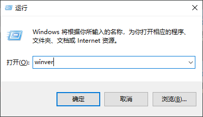

2. 弹出的“关于”窗口中显示了当前系统的 Version 及 OS Build，确保它大于要求版本

   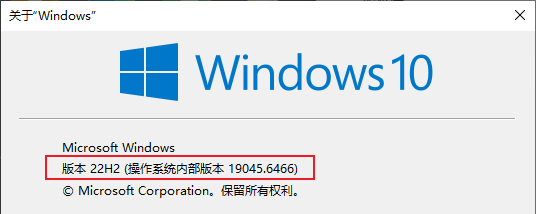

### 1.1.2 在 BIOS 开启 Intel VT-x 或 AMD-V 虚拟化

查看当前设备是否开启虚拟化：

1. `Ctrl`+`Alt`+`Del`打开全屏蓝色菜单，单击“任务管理器”

2. 如果看到的是“简略信息”窗口，`Alt`+`D`或单击左下角“详细信息”按钮，切换为“详细信息”窗口

   

3. “详细信息”窗口中，单击顶部“性能”选项卡，默认选中左侧“CPU”设备。在右下角参数区域找到“虚拟化”标签，确保它显示“已启用”

   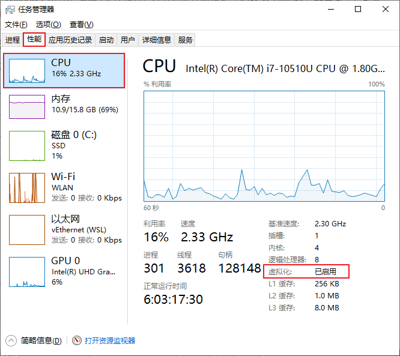

## 1.2 直接安装 WSL2

1. **管理员身份**打开 PowerShell 终端，执行 WSL 安装命令

   ```powershell
   wsl --install
   ```

   若下载进度卡死，尝试使用`--web-download`选项，绕过 Microsoft Store，直连微软服务器进行下载

   ```powershell
   wsl --install --web-download
   ```

   默认部署 Ubuntu 子系统，`-d`选项+下表`NAME`列内容，可选择部署其它 Linux 子系统

   ```powershell
   wsl --install -d Debian
   ```

   截至文档发布时，WSL 支持以下发行版：

   ```
   NAME                            FRIENDLY NAME
   Ubuntu                          Ubuntu
   Ubuntu-26.04                    Ubuntu 26.04 LTS
   Ubuntu-24.04                    Ubuntu 24.04 LTS
   Ubuntu-22.04                    Ubuntu 22.04 LTS
   openSUSE-Tumbleweed             openSUSE Tumbleweed
   openSUSE-Leap-16.1              openSUSE Leap 16.1
   RLCPlus-9                       Rocky Linux Plus 9 (CIQ)
   RLCPlus-10                      Rocky Linux Plus 10 (CIQ)
   SUSE-Linux-Enterprise-15-SP7    SUSE Linux Enterprise 15 SP7
   SUSE-Linux-Enterprise-16.1      SUSE Linux Enterprise 16.1
   kali-linux                      Kali Linux Rolling
   Debian                          Debian GNU/Linux
   AlmaLinux-8                     AlmaLinux OS 8
   AlmaLinux-9                     AlmaLinux OS 9
   AlmaLinux-Kitten-10             AlmaLinux OS Kitten 10
   AlmaLinux-10                    AlmaLinux OS 10
   archlinux                       Arch Linux
   FedoraLinux-45                  Fedora Linux 45
   FedoraLinux-44                  Fedora Linux 44
   eLxr                            eLxr 12.12.0.0 GNU/Linux
   AzureLinux-4                    Azure Linux 4
   OracleLinux_7_9                 Oracle Linux 7.9
   OracleLinux_8_10                Oracle Linux 8.10
   OracleLinux_9_5                 Oracle Linux 9.5
   SUSE-Linux-Enterprise-15-SP6    SUSE Linux Enterprise 15 SP6
   ```

2. 命令会下载并部署 WSL 相关组件，若显示以下提示，请**重启计算机**

   ```
   请求的操作成功。直到重新启动系统前更改将不会生效。
   ```

3. 重启计算机后，重复第 1 步操作：**管理员身份**打开 PowerShell 终端，执行 WSL 安装命令

   ```powershell
   wsl --install
   ```

4. 命令会继续下载并部署目标 Linux 子系统，并在结束时自动**进入子系统**引导用户完成账户配置

   ```
   ...
   Create a default Unix user account: # 输入用户名
   New password:                       # 输入密码
   Retype new password:                # 重复输入密码
   ...
   Would you like to opt-in to platform metrics collection (Y/n)? To see an example of the data collected, enter 'e'.
   [Y/n/e]:                            # 是否参加用户数据收集计划
   ```

5. 此时用户已在子系统中，输入`exit`可退出子系统

6. 回到 PowerShell，执行命令查看刚才部署的子系统

   ```powershell
   wsl -l -v
   ```

   应能看到以下输出，VERSION 为 2

   ```
     NAME      STATE           VERSION
   * Ubuntu    Stopped         2
   ```

## 1.3 从 WLS1 升级到 WSL2

1. 执行`wsl -l -v`命令看到子系统 VERSION 为 1

   ```
     NAME      STATE           VERSION
   * Ubuntu    Running         1
   ```

2. 停止正在运行的 WSL 实例

   ```powershell
   wsl -t Ubuntu
   ```

3. 将指定子系统转换为 WSL2

   ```powershell
   wsl --set-version Ubuntu 2
   ```

4. 默认安装 WSL2 版本

   ```powershell
   wsl --set-default-version 2
   ```

# 2 WSL 基础命令

| 操作 | 命令 |
| --- | --- |
| 查看已部署子系统运行状态 | wsl -l -v |
| 进入指定发行版实例 | wsl -d Ubuntu |
| 停止正在运行的指定实例 | wsl -t Ubuntu |
| 停止正在运行的**所有**实例 | wsl --shutdown |
| 查看 WSL 支持的所有发行版 | wsl -l -o |
| 查看帮助 | wsl --help |

# 3 使用 SSH 登录 WSL 实例

## 3.1 在 WSL 实例内配置 SSH 服务

1. 命令行进入 WSL 实例

   ```powershell
   wsl -d Ubuntu
   ```

2. 更新软件源并安装 OpenSSH 服务

   ```bash
   sudo apt update
   sudo apt install openssh-server -y
   ```

3. 编辑 SSH 配置文件，**解除注释**并修改以下配置项

   ```bash
   sudo vim /etc/ssh/sshd_config
   ```

   - `Port`：设置为任意非标准端口`49152-65535`，避免默认的 22 端口和 Windows 本地 SSH 服务冲突
   - `PubkeyAuthentication`：设置为`yes`，允许公钥认证
   - `PasswordAuthentication`：设置为`yes`，允许密码认证（按需配置）

4. 重启 SSH 服务，使能配置

   ```bash
   sudo systemctl daemon-reload
   sudo systemctl restart ssh.socket
   ```

5. 检查 SSH 监听是否生效

   ```bash
   systemctl status ssh.socket
   ```

   应显示以下内容：

   - `Active`：active (running)
   - `Listen`：正在监听刚才设置的**非标准端口**

   ```
   ● ssh.socket - OpenBSD Secure Shell server socket
        Loaded: loaded (/usr/lib/systemd/system/ssh.socket; enabled; preset: enabled)
       Drop-In: /run/systemd/generator/ssh.socket.d
                └─addresses.conf
        Active: active (running) since Fri 2026-11-20 02:23:08 CST; 6min ago
    Invocation: f4c36db861654cc382dbe9a1e1ab50bf
      Triggers: ● ssh.service
        Listen: 0.0.0.0:58342 (Stream)
                [::]:58342 (Stream)
         Tasks: 0 (limit: 19108)
        Memory: 12K (peak: 512K)
           CPU: 1ms
        CGroup: /system.slice/ssh.socket

   Nov 20 02:23:08 DESKTOP-TIOG1FO systemd[1]: Listening on ssh.socket - OpenBSD Secure Shell server socket.
   ```

6. 检查 SSH 服务是否被配置为开机自启

   ```bash
   systemctl is-enabled ssh.socket
   ```

   应显示`enabled`。若显示`disabled`，执行以下命令配置开机自启

   ```bash
   sudo systemctl enable ssh.socket
   ```

## 3.2 配置 SSH 免密

1. 回到 Windows 宿主机，在 PowerShell 中生成密钥对**（若已有密钥对，跳过此步骤）**​

   ```powershell
   ssh-keygen -t ed25519
   ```

2. 连续键入`Enter`直至命令结束，终端显示一副字符组成的 Randomart Image

3. 打开`C:\Users\<win_user>\.ssh`目录，应有私钥文件`id_ed25519`和公钥文件`id_ed25519.pub`

4. 打开 PowerShell，进入 WSL

   ```powershell
   wsl -d Ubuntu
   ```

5. 创建`.ssh`目录并**配置权限**：

   ```bash
   mkdir -p ~/.ssh
   chmod 700 ~/.ssh
   ```

6. 创建`authorized_keys`文件并**配置权限**​

   ```bash
   touch ~/.ssh/authorized_keys
   chmod 600 ~/.ssh/authorized_keys
   ```

7. 用文本编辑器打开刚才在 **Windows 宿主机**中生成的公钥文件`id_ed25519.pub`，将**文件内容**复制到`authorized_keys`文件中，保存文件，完成免密配置

## 3.3 SSH 连接 WSL

### 3.3.1 使用 SSH 命令连接

在 Windows 宿主机，执行 SSH 命令登录 WSL

```powershell
ssh <wsl_user>@localhost -p <port>
```

- `wsl_user`：WSL 用户名，可在 WSL 实例内使用`whoami`命令查询
- `port`：3.1 节第 3 步在`sshd_config`文件中配置的端口号
- 若已参考 2.3 节完成免密配置，**不应提示输入密码**

### 3.3.2 使用 SSH Config 连接

1. 若使用 Tabby Terminal、Visual Studio Code 远程插件等工具连接 WSL，还需配置 SSH Config 文件

2. 在 Windows 宿主机，创建`C:\Users\<win_user>\.ssh\config`文件并使用文本编辑器打开，添加以下配置

   ```
   Host wsl               # 自定义别名
       HostName localhost # 本地主机 (127.0.0.1)
       User <wsl_user>    # WSL 用户名
       Port <port>        # WSL 中配置的端口号
       IdentityFile C:\Users\<win_user>\.ssh\id_ed25519 # 私钥文件路径
   ```

3. 保存文件后，可直接用 SSH Config 配置的别名登录 WSL

   ```powershell
   ssh wsl
   ```

4. 打开 Tabby Terminal“配置和连接”设置，应识别到 SSH Config 配置

   

5. 打开 Visual Studio Code 远程插件，应识别到 SSH Config 配置

   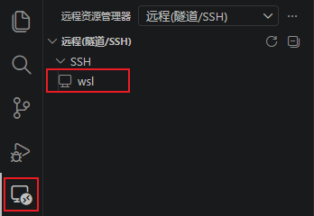

## 3.4 开机自启 WSL 实例

没有交互式会话登录 WSL 子系统实例时，WSL 会在 15 秒内自动关闭，这时用户无法再通过 SSH 连接 WSL。需要配置一个**不依赖用户登录、开机时自动唤醒**的 WSL 会话，令其后台常驻进程，确保 WSL 实例能像云服务器那样随时响应 SSH 连接

### 3.4.1 使用 Windows 任务计划程序

1. `Win`+`R`打开“运行”窗口，输入`taskschd.msc`并单击“确定”

   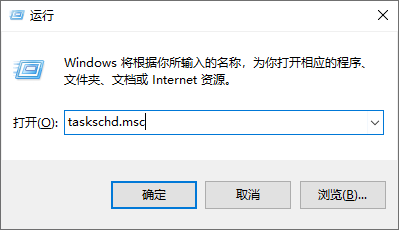

2. 弹出的“任务计划程序”窗口中，单击右侧“操作”栏下的“创建任务”

   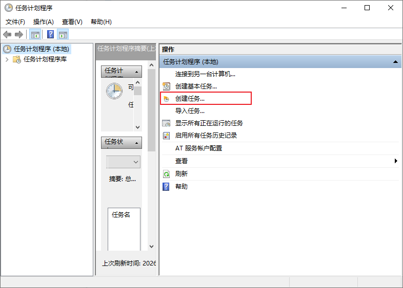

3. 弹出的“创建任务”窗口中，在默认“常规”选项卡下填写任务名称，并勾选“不管用户是否登录都要运行”和“使用最高权限运行”

   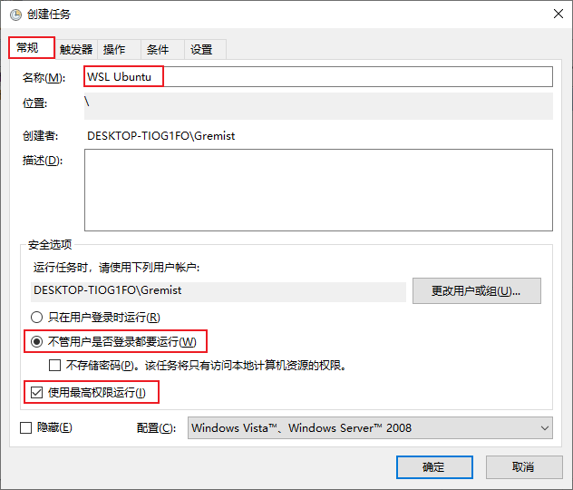

4. 切换到“触发器”选项卡，单击“新建”

   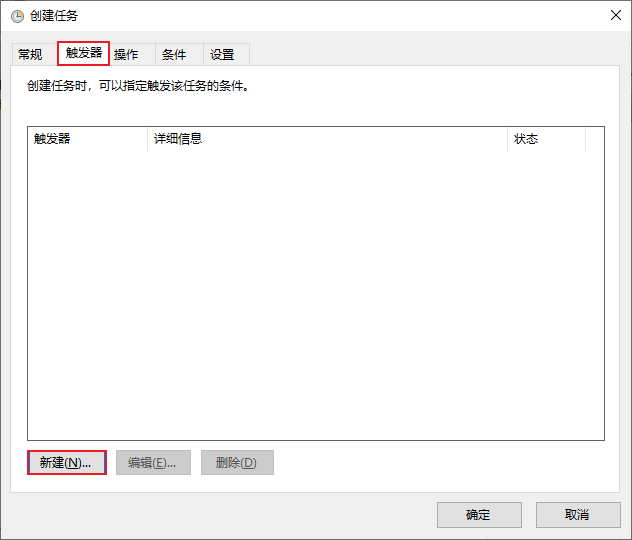

5. 弹出的“新建触发器”窗口中，“开始任务”选择“启动时”，单击“确定”

   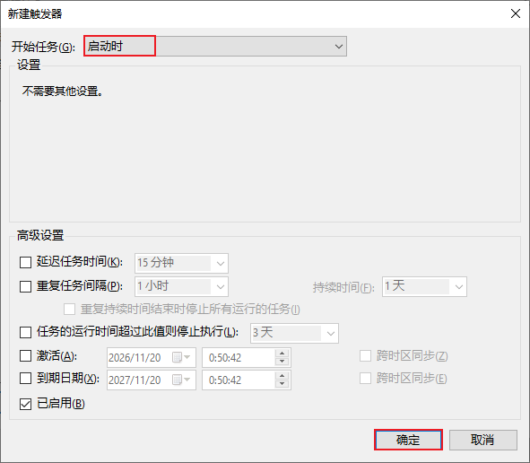

6. 切换到“操作”选项卡，同样单击“新建”

7. 弹出的“新建操作”选项卡中，填写以下内容，单击“确定”：

   - 程序或脚本：`C:\Windows\System32\wsl.exe`
   - 添加参数：`-d Ubuntu --exec sleep infinity`

   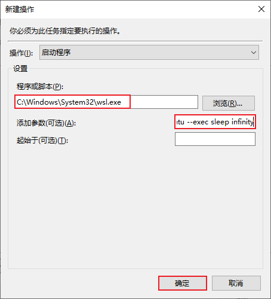

8. 切换到“条件”选项卡，取消勾选“只有在计算机使用交流电源时才启动此任务”

   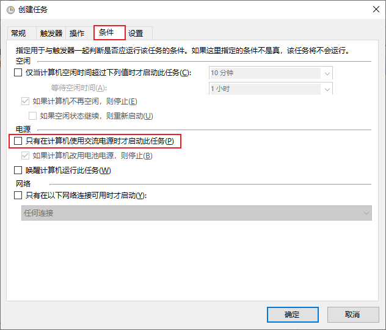

9. 切换到“设置”选项卡，进行以下配置，最后点“确定”：

   - 勾选“如果过了计划开始时间，立即启动任务”
   - 勾选“如果任务失败，按以下频率重新启动”，并按需配置重启频率和次数
   - **取消勾选“如果任务运行时间超过以下时间，停止任务”**

   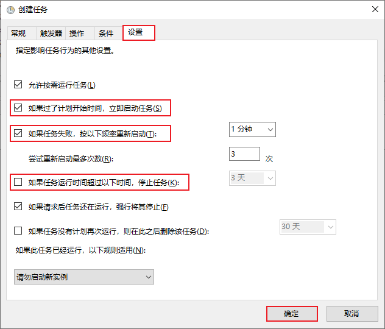

10. 弹出的“任务计划程序”窗口中，输入 Windows 密码，单击“确定”完成配置

    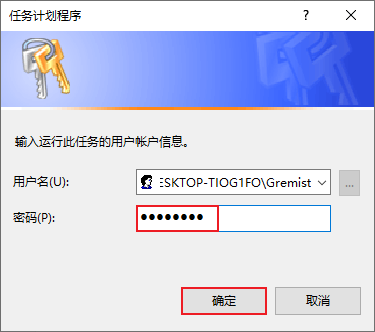

11. 重启计算机后，执行`wsl -l -v`命令，STATE 应显示 Running

# 4 将 WSL 迁移到其它磁盘

WSL 子系统默认部署在`C:`盘，若磁盘空间紧张，按以下步骤将指定子系统迁移到其它磁盘

1.
